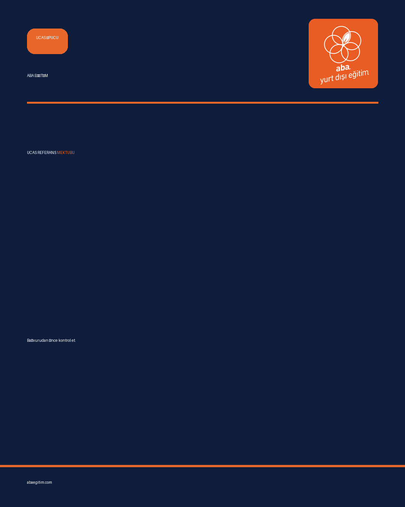
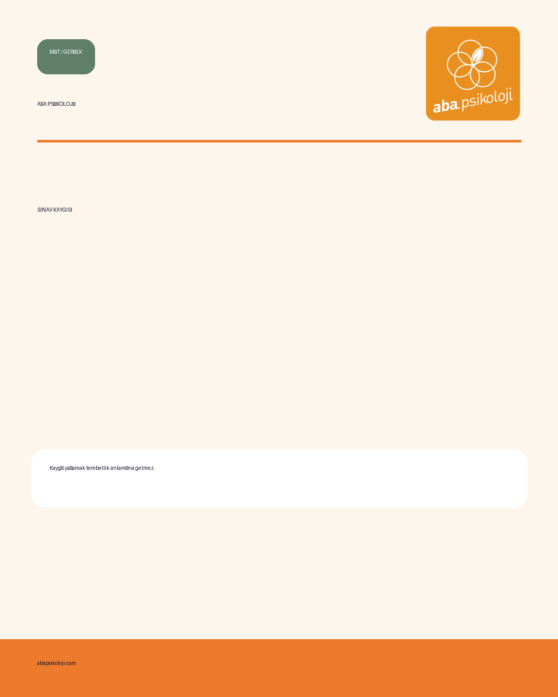
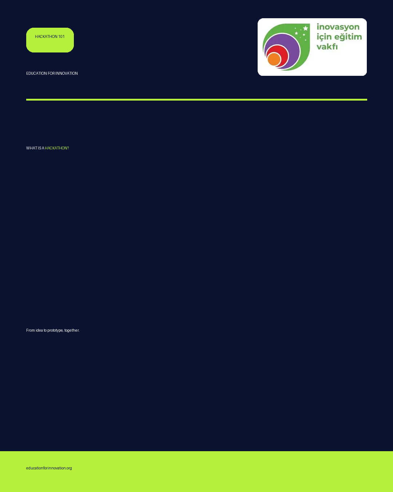
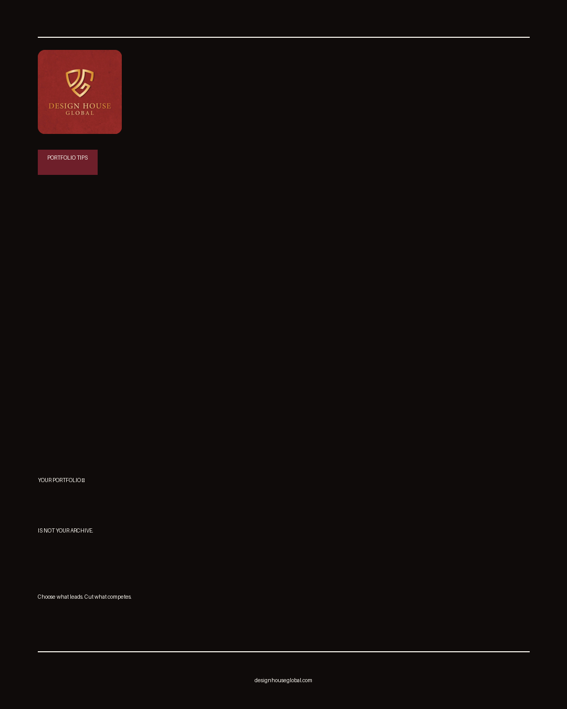

# Brand Intelligence & Content Agent

Python + Streamlit prototype for brand-aware social content generation, developed as a startup trial project.

## What it does
- Uses structured JSON configurations to represent brand-specific visual and writing guidelines.
- Generates 1080 × 1350 social post images with a rule-based offline mode.
- Provides a Streamlit interface for choosing brands and generation settings.
- Includes an optional OpenAI-powered copywriting mode (**not verified with a live API call**).
- Contains 12 example outputs for four brand configurations.

## Tech stack
Python, Streamlit, Pillow, JSON, OpenAI API (optional), python-dotenv.

## Getting started
Requires Python 3.10+.

```bash
python -m venv .venv
source .venv/bin/activate  # Windows: .venv\Scripts\activate
pip install -r requirements.txt
streamlit run app.py
```

Generate offline examples:

```bash
python agent.py --brand all
python agent.py --brand E4I --index 0 --output demo.png
```

For optional AI mode, copy `.env.example` to `.env` and provide your own API key. Never commit `.env`.

## Example outputs

| Education | Psychology |
|---|---|
|  |  |

| Innovation | Design studio |
|---|---|
|  |  |

## Scope and limitations
- Offline mode is **rule-based**, not generative AI.
- AI copy generation has **not been validated in a live API test**.
- Some Instagram palette values are approximate, and fallback fonts may differ from brand fonts.
- Design House uses an available profile image rather than the specified outline mark.
- Generated outputs require human review before publication.
- Logos, trademarks, and brand names belong to their respective owners. **Obtain permission before publishing these assets or client-specific guidelines.**

## Project context
Portfolio case study based on a startup task. This repository is a prototype and does not claim production deployment or commercial results.
